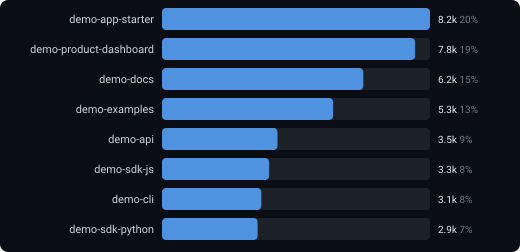

> **Public synthetic demo.** This repository is generated as a Reponomics showcase. The dashboard data is synthetic, the committed README dashboard is demo-only, and the Pages dashboard key is intentionally public.

# Reponomics Dashboard

<!-- Workflow badge hidden pending a deliberate dashboard status design. -->
<!--

-->

  [View latest updates](docs/reponomics/README.md)

Latest data capture: 2026-11-01 12:00 UTC

<picture>
  <source media="(prefers-color-scheme: light)" srcset="docs/assets/hero-stats-light.svg">
  
</picture>

⭐ Best overall day: **706 views** (44d ago) &nbsp;·&nbsp; 🏆 Best single-repo day: **`demo-product-dashboard`** 219 on 2026-09-18

**Growth (14d):** attention **40,299 views** / **22,070 visitors**; interest **+22 stars** / **+4 watchers** (now 471 / 117); adoption **5,310 clones** / **+3 forks** (now 61).

### Views Trend

<picture>
  <source media="(prefers-color-scheme: light)" srcset="docs/assets/sparkline-light.svg">
  
</picture>

### Activity

<picture>
  <source media="(prefers-color-scheme: light)" srcset="docs/assets/activity-light.svg">
  
</picture>

<strong>Top Repositories &amp; Share</strong>

<picture>
  <source media="(prefers-color-scheme: light)" srcset="docs/assets/bar-chart-light.svg">
  
</picture>

<picture>
  <source media="(prefers-color-scheme: light)" srcset="docs/assets/donut-light.svg">
  
</picture>

### Insights

- `reponomics-demo/demo-examples` views +9% over the last 7d (440 -> 481, +41).
- `reponomics-demo/demo-docs` views +3% over the last 7d (577 -> 593, +16).
- `reponomics-demo/demo-product-dashboard` views -2% over the last 7d (589 -> 575, -14).

<strong>Repositories</strong> &mdash; top 8 of 8

| Repository | Views | Visitors | Clones | Cloners |
|------------|------:|---------:|-------:|--------:|
| reponomics-demo/demo-app-starter | 8,238 | 4,239 | 1,028 | 546 |
| reponomics-demo/demo-product-dashboard | 7,781 | 4,195 | 739 | 386 |
| reponomics-demo/demo-docs | 6,189 | 3,483 | 139 | 47 |
| reponomics-demo/demo-examples | 5,259 | 3,085 | 1,108 | 599 |
| reponomics-demo/demo-api | 3,549 | 2,154 | 379 | 154 |
| reponomics-demo/demo-sdk-js | 3,292 | 1,664 | 556 | 286 |
| reponomics-demo/demo-cli | 3,051 | 1,694 | 810 | 427 |
| reponomics-demo/demo-sdk-python | 2,940 | 1,556 | 551 | 285 |

<strong>Repository Growth</strong> &mdash; top 8 by growth

| Repository | Attention | Interest growth | Adoption growth |
|------------|----------:|----------------:|----------------:|
| `reponomics-demo/demo-app-starter` | 8,238 views / 4,239 visitors | +4 stars (43) / +1 watchers (10) | 1,028 clones / +1 forks (6) |
| `reponomics-demo/demo-product-dashboard` | 7,781 views / 4,195 visitors | +3 stars (48) / +1 watchers (12) | 739 clones / +1 forks (7) |
| `reponomics-demo/demo-docs` | 6,189 views / 3,483 visitors | +3 stars (51) / +1 watchers (13) | 139 clones / +1 forks (7) |
| `reponomics-demo/demo-examples` | 5,259 views / 3,085 visitors | +3 stars (56) / +1 watchers (14) | 1,108 clones / +0 forks (7) |
| `reponomics-demo/demo-api` | 3,549 views / 2,154 visitors | +3 stars (59) / +0 watchers (14) | 379 clones / +0 forks (7) |
| `reponomics-demo/demo-sdk-js` | 3,292 views / 1,664 visitors | +2 stars (65) / +0 watchers (16) | 556 clones / +0 forks (8) |
| `reponomics-demo/demo-cli` | 3,051 views / 1,694 visitors | +2 stars (78) / +0 watchers (20) | 810 clones / +0 forks (10) |
| `reponomics-demo/demo-sdk-python` | 2,940 views / 1,556 visitors | +2 stars (71) / +0 watchers (18) | 551 clones / +0 forks (9) |

<strong>Top Referrers</strong> &mdash; 8 sources

| Referrer | Views | Uniques |
|----------|------:|--------:|
| github.com | 2,736 | 1,666 |
| google.com | 1,770 | 1,074 |
| docs.github.com | 1,044 | 633 |
| news.ycombinator.com | 641 | 387 |
| reddit.com | 480 | 288 |
| stackoverflow.com | 398 | 239 |
| npmjs.com | 319 | 190 |
| pypi.org | 238 | 140 |

<strong>Popular Content</strong> &mdash; top 10 paths

| Repository | Content | Views | Uniques |
|------------|---------|------:|--------:|
| `reponomics-demo/demo-app-starter` | Repository overview | 549 | 312 |
| `reponomics-demo/demo-product-dashboard` | Repository overview | 518 | 295 |
| `reponomics-demo/demo-docs` | Repository overview | 412 | 234 |
| `reponomics-demo/demo-examples` | Repository overview | 350 | 199 |
| `reponomics-demo/demo-app-starter` | README | 247 | 140 |
| `reponomics-demo/demo-api` | Repository overview | 236 | 134 |
| `reponomics-demo/demo-product-dashboard` | README | 233 | 132 |
| `reponomics-demo/demo-sdk-js` | Repository overview | 219 | 124 |
| `reponomics-demo/demo-cli` | Repository overview | 203 | 115 |
| `reponomics-demo/demo-sdk-python` | Repository overview | 196 | 111 |

---

[Setup & Docs](docs/reponomics/README.md)

Generated by [Reponomics Dashboard Template](https://github.com/reponomics/reponomics-dashboard)
